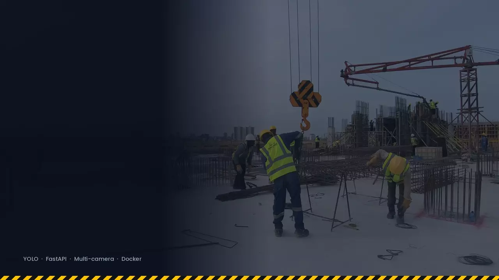

<div align="center">

<a href="Visuals/ppe-detection-demo.mp4">
  
</a>

<sub>▶ <a href="Visuals/ppe-detection-demo.mp4">Watch the full-quality video</a></sub>

# 🦺 Construction Safety Detection
### Real-time PPE monitoring with YOLOv8 — scalable API, web dashboard, and multi-camera support

[](https://www.python.org/)
[](https://fastapi.tiangolo.com/)
[](https://github.com/ultralytics/ultralytics)
[](https://www.docker.com/)
[](LICENSE)
[](https://github.com/Ansarimajid/Construction-PPE-Detection/pulls)

**Detect helmets, vests, and masks in real-time — log every violation, stream live feeds to a web dashboard, and alert your team instantly.**

[Features](#-features) · [Quick Start](#-quick-start) · [API Reference](#-api-reference) · [Architecture](#-architecture) · [Contributing](#-contributing)

</div>

---

## Why This Project?

Construction sites are among the most hazardous work environments. Manual supervision of PPE compliance is unreliable and resource-intensive. This project automates safety monitoring using **YOLOv8** and exposes a production-ready **FastAPI** backend — supporting multiple camera feeds, a persistent violation log, a live web dashboard, and pluggable alert channels.

---

## Features

### Detection
| Feature | Description |
|---|---|
| 🪖 **Helmet Detection** | Identifies whether workers are wearing hard hats |
| 🦺 **Vest Detection** | Detects high-visibility safety vests |
| 😷 **Mask Detection** | Monitors mask compliance on site |
| 🧍 **Person Detection** | Tracks worker presence in the frame |
| 🆔 **Worker Tracking** | Stable per-worker IDs across frames; violations and alerts are raised per worker |
| 🦴 **Pose Estimation** | YOLO pose keypoints locate each worker's head and torso so hardhats and vests are assigned to the right person |
| 📊 **Live Counts Overlay** | Real-time detection counts on the video feed |

### Infrastructure
| Feature | Description |
|---|---|
| 🌐 **REST API** | FastAPI backend with full CRUD, streaming, and export endpoints |
| 📷 **Multi-Camera** | Webcam, RTSP streams, and video files — unlimited concurrent feeds |
| 🗄️ **Violation Log** | Every violation saved to SQLite (dev) or PostgreSQL (prod) with frame snapshot |
| 📡 **Live Dashboard** | Bootstrap 5 web UI with MJPEG stream and real-time WebSocket counts |
| 📧 **Email Alerts** | Async SMTP alerts with violation frame attached |
| 🔗 **Webhook Alerts** | HTTP POST to any endpoint (Slack, Teams, custom) |
| 🐳 **Docker** | Production-ready Docker + docker-compose with PostgreSQL |
| ✅ **Tests & CI** | pytest unit + integration tests, GitHub Actions CI pipeline |

---

## Quick Start

### Option 1: API Server (Recommended)

```bash
# 1. Clone the repo
git clone https://github.com/Ansarimajid/Construction-PPE-Detection.git
cd Construction-PPE-Detection

# 2. Install dependencies
pip install -r requirements/base.txt

# 3. Configure environment
cp .env.example .env
# Edit .env with your email credentials (optional)

# 4. Start the server
uvicorn app.main:app --reload
```

Open **http://localhost:8000** for the web dashboard, or **http://localhost:8000/docs** for the interactive API.

---

### Option 2: Docker (Production)

```bash
cp .env.example .env
# Edit .env with your settings

docker compose up
```

The full stack starts — FastAPI app + PostgreSQL + persistent violation frame storage. Open **http://localhost:8000**.

---

### Option 3: Docker (Dev, hot-reload + SQLite)

```bash
docker compose -f docker-compose.yml -f docker-compose.dev.yml up
```

---

### Option 4: Legacy Standalone Mode

The original single-file script still works as before:

```bash
conda env create -f yolo_env.yml && conda activate yolo
# or: pip install -r requirements/base.txt
python webcam.py
```

---

## Configuration

Copy `.env.example` to `.env` and fill in your values:

```env
# Application
APP_ENV=dev
LOG_LEVEL=INFO

# Database (SQLite for dev, PostgreSQL for prod)
DATABASE_URL=sqlite+aiosqlite:///./ppe_detection.db

# Model
MODEL_PATH=Model/ppe.pt
DETECTION_CONFIDENCE=0.5

# Alert timing (seconds)
ALERT_COOLDOWN_SECONDS=10

# Person tracking
ENABLE_TRACKING=true
TRACK_IOU_THRESHOLD=0.3
TRACK_MAX_AGE=30          # frames a lost worker keeps their ID
TRACK_MIN_HITS=3          # frames before a worker gets an ID
PPE_SMOOTHING_WINDOW=15   # majority vote of each worker's PPE status (1 = off)

# Pose estimation (weights auto-download on first run)
ENABLE_POSE=true
POSE_MODEL_PATH=yolo11n-pose.pt
POSE_CONFIDENCE=0.5

# Email (Gmail — requires App Password)
SENDER_EMAIL=your_email@gmail.com
RECEIVER_EMAIL=receiver@example.com
EMAIL_PASSWORD=your_app_password

# Optional: generic HTTP webhook
WEBHOOK_URL=https://hooks.example.com/alerts
```

> **Gmail users:** Generate an [App Password](https://support.google.com/accounts/answer/185833) — your regular password won't work with SMTP.

> **Tracking & pose:** with tracking on, each worker gets their own `VIOLATION_PERSIST_SECONDS` timer and `ALERT_COOLDOWN_SECONDS` cooldown, and the worker ID is stored on the violation (`track_id`). Pose is optional — if the pose model can't be loaded the app logs a warning and assigns PPE using the person box alone. Set `ENABLE_TRACKING=false` to restore the original per-camera behaviour.

> **Never commit `.env`** — it's already in `.gitignore`.

---

## API Reference

| Method | Endpoint | Description |
|--------|----------|-------------|
| `GET` | `/api/v1/health` | System health + active camera count |
| `GET` | `/api/v1/metrics` | Per-camera detection counts |
| `GET` | `/api/v1/cameras` | List all cameras |
| `POST` | `/api/v1/cameras` | Add a camera |
| `POST` | `/api/v1/cameras/{id}/start` | Start processing a camera |
| `POST` | `/api/v1/cameras/{id}/stop` | Stop processing a camera |
| `GET` | `/api/v1/violations` | Query violations (filter by camera, date, type) |
| `GET` | `/api/v1/violations/export` | Download violations as CSV |
| `GET` | `/api/v1/stream/{camera_id}` | MJPEG live video stream |
| `WS` | `/api/v1/ws/{camera_id}` | WebSocket: live detection counts (JSON) |

Full interactive docs available at `/docs` (Swagger UI) and `/redoc`.

### Example: Add and start a webcam

```bash
# Add camera
curl -X POST http://localhost:8000/api/v1/cameras \
  -H "Content-Type: application/json" \
  -d '{"name": "Site Entrance", "source_type": "webcam", "source_uri": "0"}'

# Start it (use the id returned above)
curl -X POST http://localhost:8000/api/v1/cameras/1/start

# Stream in browser
open http://localhost:8000/api/v1/stream/1
```

### Example: Add an RTSP camera

```bash
curl -X POST http://localhost:8000/api/v1/cameras \
  -H "Content-Type: application/json" \
  -d '{"name": "Gate Camera", "source_type": "rtsp", "source_uri": "rtsp://192.168.1.100/stream"}'
```

---

## Architecture

```
┌─────────────────────────────────────────────────────────────┐
│                  FastAPI Application                        │
│                                                             │
│  ┌──────────────┐   ┌──────────────┐   ┌────────────────┐  │
│  │ CameraManager│   │  PPEDetector │   │ViolationChecker│  │
│  │ (async tasks)│──▶│  (YOLOv8)    │──▶│ (per-camera    │  │
│  │ per camera   │   │  inference   │   │  state + rules)│  │
│  └──────────────┘   └──────────────┘   └───────┬────────┘  │
│                                                 │           │
│                                        ┌────────▼────────┐  │
│                                        │ AlertDispatcher  │  │
│                                        │  ┌────────────┐  │  │
│                                        │  │EmailHandler│  │  │
│                                        │  │WebhookHandl│  │  │
│                                        │  │DB Handler  │  │  │
│                                        │  └────────────┘  │  │
│                                        └─────────────────┘  │
│                                                             │
│  REST API (/api/v1/*)   MJPEG stream   WebSocket counts     │
│  SQLite / PostgreSQL    violation_frames/ (filesystem)      │
└─────────────────────────────────────────────────────────────┘
```

### Camera sources
- **Webcam** — `source_type: "webcam"`, `source_uri: "0"` (device index)
- **RTSP** — `source_type: "rtsp"`, `source_uri: "rtsp://..."`
- **Video file** — `source_type: "file"`, `source_uri: "/path/to/video.mp4"`

### Alert handlers
All handlers run concurrently per violation. A failure in one (e.g. SMTP timeout) never blocks the others.

---

## Project Structure

```
Construction-PPE-Detection/
├── app/
│   ├── main.py                  # FastAPI app factory + lifespan
│   ├── core/
│   │   ├── config.py            # Pydantic settings (all env vars)
│   │   ├── detector.py          # YOLOv8 wrapper
│   │   ├── tracker.py           # IoU multi-object tracker (worker IDs)
│   │   ├── pose.py              # YOLO pose keypoint estimator
│   │   ├── ppe_assigner.py      # Assigns hardhats/vests to tracked workers
│   │   ├── violation_checker.py # Business rules, per-camera / per-worker state
│   │   └── frame_annotator.py   # Bounding box / overlay drawing
│   ├── camera/                  # Webcam, RTSP, file sources + manager
│   ├── alerts/                  # Email, webhook, database handlers
│   ├── api/routes/              # REST endpoints
│   ├── db/                      # SQLAlchemy models + session
│   ├── schemas/                 # Pydantic request/response models
│   └── static/                  # Web dashboard (HTML/JS/CSS)
├── tests/
│   ├── unit/                    # Tracker, PPE assigner, violation checker, dispatcher, config
│   └── integration/             # API endpoint tests
├── docker/
│   ├── Dockerfile               # Production image (python:3.11-slim)
│   └── Dockerfile.dev           # Dev image with hot-reload
├── requirements/
│   ├── base.txt                 # Runtime dependencies
│   ├── dev.txt                  # + pytest, ruff
│   └── prod.txt                 # + gunicorn, asyncpg
├── docker-compose.yml           # App + PostgreSQL (production)
├── docker-compose.dev.yml       # SQLite + hot-reload (development)
├── pyproject.toml               # Ruff config + project metadata
├── .env.example                 # Config template (commit this, not .env)
├── webcam.py                    # Legacy standalone script
└── Model/ppe.pt                 # YOLOv8 weights
```

---

## Running Tests

```bash
pip install -r requirements/dev.txt
pytest tests/ -v
```

Tests use an in-memory SQLite database and mock the YOLO model — no webcam or GPU required.

---

## Detection Classes

The model detects 10 classes:

| Class | Color |
|-------|-------|
| Hardhat | Blue |
| Mask | Green |
| NO-Hardhat | Red |
| NO-Mask | Cyan |
| NO-Safety Vest | Magenta |
| Person | Yellow |
| Safety Cone | Purple |
| Safety Vest | Olive |
| Machinery | Teal |
| Vehicle | Gray |

---

## Contributing

Contributions are welcome! Here's how to get started:

1. **Fork** the repository
2. **Create** a feature branch: `git checkout -b feature/your-feature`
3. **Install dev deps**: `pip install -r requirements/dev.txt`
4. **Run tests** before pushing: `pytest tests/ -v`
5. **Commit** your changes: `git commit -m 'Add some feature'`
6. **Open** a Pull Request

See [CONTRIBUTING.md](CONTRIBUTING.md) for detailed guidelines.

---

## Requirements

- Python 3.9+
- See `requirements/base.txt` for the full dependency list
- Docker + Docker Compose (for containerised deployment)
- A Gmail App Password (for email alerts) — [how to generate one](https://support.google.com/accounts/answer/185833)

---

## License

This project is licensed under the **MIT License** — see the [LICENSE](LICENSE) file for details.

---

## Acknowledgments

- [Ultralytics YOLOv8](https://github.com/ultralytics/ultralytics) for the detection backbone
- [FastAPI](https://fastapi.tiangolo.com/) for the async web framework
- The open-source computer vision community for datasets and insights

---

<div align="center">

**If this project helped you, consider giving it a star — it helps others find it!**

</div>
